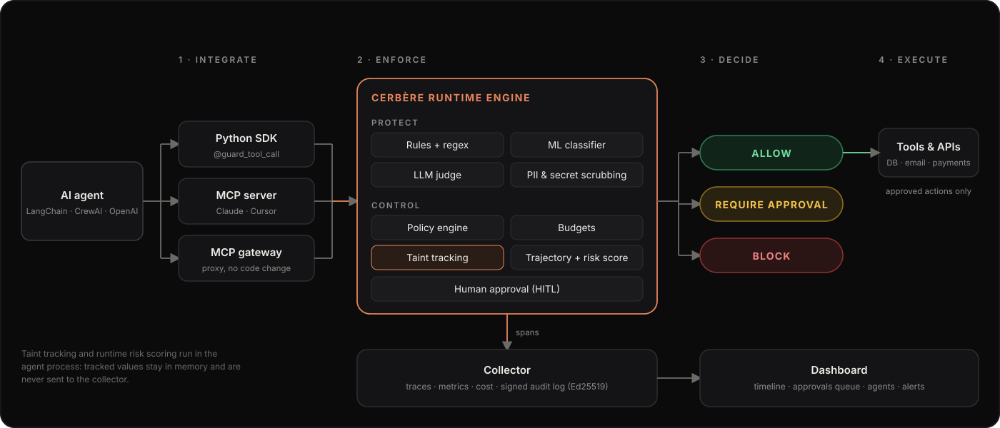

# Cerbere AG

<div align="center">


### Runtime security for autonomous AI agents

**Control what your agents can do — before their actions reach your tools, systems and data.**

Cerbere is a self-hosted runtime security and observability layer for autonomous agents. It evaluates tool actions, enforces policies, tracks sensitive data, and records evidence across agent workflows.

We are starting with **coding agents** — where terminal, filesystem, Git and MCP access create a direct operational attack surface — while keeping the same security layer available to business agents, workflow agents and custom agent systems.

[](LICENSE)


[](https://pypi.org/project/cerbere-ag/)
[](https://github.com/chrismsmr-celcom/cerbere-AG/actions/workflows/ci.yml)

[Quick start](#quick-start) · [Coding agents](#coding-agents) · [How it works](#how-it-works) · [Other agents](#beyond-coding-agents) · [Self-hosting](#self-hosting) · [Roadmap](#roadmap)

</div>

---

## Why runtime security

An autonomous agent can do more than generate text. It can read source files, run shell commands, modify repositories, call external services, access business data and delegate work.

Prompt filtering alone does not govern those actions. Cerbere focuses on the execution boundary: **what action is being attempted, which agent is attempting it, what data is involved, and whether the action should proceed.**

Cerbere is not an agent framework or an orchestrator. It does not choose tasks or coordinate work between agents. It governs the security and evidence around the actions agents perform.

## What Cerbere does

| Capability | What it does |
|---|---|
| **Runtime enforcement** | Evaluates tool calls before execution; allows, blocks or routes risky actions for human approval. |
| **Identity and authorization** | Associates activity with registered agent identities and applies agent-level policies and tool allowlists. |
| **Data protection** | Detects PII and secrets, tracks sensitive data through guarded flows, and blocks unsafe outbound use. |
| **Observability** | Captures model and tool spans, latency, token usage, cost and security decisions. |
| **Audit evidence** | Records security events in a hash-chained audit trail with signed checkpoints and action-bound signed decisions. |
| **Self-hosting** | Runs the collector, dashboard and policy infrastructure on your own environment. |

Cerbere is defense in depth, not a guarantee that every attack will be detected. It should complement — not replace — operating-system isolation, least-privilege credentials, network controls and code review.

## Coding agents

Coding agents are our first focused integration surface because their tools can change real systems: source files, shell environments, repositories, credentials and deployment workflows.

### Current integration status

| Agent / surface | Connection today | Status |
|---|---|---|
| Claude Code | Connect through Cerbere's MCP server or place the MCP gateway in front of MCP tools | Available through MCP |
| Cursor | Connect through Cerbere's MCP server or gateway | Available through MCP |
| Other MCP-compatible coding agents | Use the MCP server or gateway where the client supports MCP | Available, client-dependent |
| Native lifecycle hooks | Agent-specific hooks for command, file, prompt and tool-result events | In development |

**Important distinction:** MCP integration does not automatically intercept every native action an agent can perform. For example, connecting an MCP server does not by itself mediate a coding agent's direct shell or filesystem operations. Native hooks and other enforcement adapters are needed for those surfaces. We will document each agent's actual event coverage as it is implemented and tested.

### What we are building toward

- Inspect commands and tool arguments before execution.
- Apply identity-aware permissions and explicit tool allowlists.
- Detect prompt injection and sensitive-data exposure.
- Inspect tool results for secrets and untrusted instructions before they return to the agent.
- Require human approval for high-impact or irreversible actions.
- Keep an attributable record of decisions, execution results and policy changes.

### Connect through MCP today

Cerbere ships an MCP server and a gateway. The server exposes security utilities an agent can call. The gateway is the enforcement component: it sits between an MCP client and upstream MCP servers and evaluates tool calls before forwarding them.

See the [MCP package guide](mcp/README.md) for installation, configuration and transport options. The experimental Claude Code native hook is documented in [Coding-agent integrations](docs/CODING_AGENT_INTEGRATIONS.md).

For Claude Code, a local MCP server can be added with:

```bash
pip install cerbere-ag-mcp
claude mcp add cerbereag \
  -e AGENTGUARD_MCP_COLLECTOR_URL=http://localhost:8080 \
  -e AGENTGUARD_API_KEY=ag-your-key \
  -- cerbere-ag-mcp
```

For Cursor, add the server to `.cursor/mcp.json`:

```json
{
  "mcpServers": {
    "cerbereag": {
      "command": "cerbere-ag-mcp",
      "env": {
        "AGENTGUARD_MCP_COLLECTOR_URL": "http://localhost:8080",
        "AGENTGUARD_API_KEY": "ag-your-key",
        "AGENTGUARD_AGENT_ID": "my-coding-agent"
      }
    }
  }
}
```

For enforcement on calls to existing MCP servers, use the gateway rather than relying on the advisory server alone. Follow the [gateway configuration guide](mcp/README.md#the-universal-mcp-gateway).

## Quick start

### 1. Start Cerbere

```bash
git clone https://github.com/chrismsmr-celcom/cerbere-AG.git
cd cerbere-AG
./scripts/selfhost-init.sh
docker compose up -d --build
```

The dashboard is available at `http://localhost:8080`.

Create the first administrator:

```bash
docker compose exec collector python -m collector.cli create-admin --email you@company.com
```

Open `http://localhost:8080/login`, sign in and create an agent API key.

### 2. Protect a Python agent

```bash
pip install cerbere-ag
```

```python
from agentguard import AgentGuard, SecurityException

guard = AgentGuard(
    collector_url="http://localhost:8080",
    api_key="ag-your-key",
    agent_id="my-agent",
)

@guard.guard_tool_call("send_email")
def send_email(to, subject, body):
    return email_service.send(to, subject, body)

try:
    send_email(
        to="customer@example.com",
        subject="Account update",
        body="Your request is complete.",
    )
except SecurityException as exc:
    print("Blocked by Cerbere:", exc)
```

The guarded function is not called when the action is denied. Calls requiring approval are held for review according to the configured policy.

## How it works

<p align="center">
  
</p>

A typical guarded tool flow:

1. **Observe the action:** the SDK or gateway captures the agent identity, tool name, arguments and available context.
2. **Evaluate:** policy and detection layers assess authorization, risk, prompt injection, budgets and sensitive-data flow.
3. **Decide:** Cerbere returns an allow, deny or approval decision.
4. **Enforce:** the integration forwards the action only when authorized.
5. **Record:** spans, decisions and audit evidence are available to operators.

### Detection layers

1. **Rules and policy:** fast checks, tool permissions and budgets.
2. **Local ML classifier (optional):** prompt-injection classification on your infrastructure.
3. **LLM judge (optional):** reviews selected ambiguous cases; it can be configured to use a private model endpoint.

The layers run in order of cost. Clean traffic should not need the deeper checks.

### Data-flow protection

Cerbere tracks sensitive values observed through guarded flows. If a secret is later passed to a protected external tool — including common encoded representations — the outbound action can be blocked.

See [taint tracking implementation](agentguard/taint.py) and the [benchmark methodology](benchmarks/METHODOLOGY.md) for implementation details and evaluation limits.

## Beyond coding agents

The same runtime layer applies to agents that operate business systems:

- **Business workflows:** CRM updates, customer support, ticketing and internal operations.
- **Data and research agents:** database access, retrieval, file handling and external research.
- **Framework-based agents:** Python agents built with LangChain, LangGraph, CrewAI and other tool-calling frameworks.
- **MCP-connected agents:** any compatible client that can route tool calls through an MCP server or gateway.

The integration method depends on the agent's execution surface. Python agents can use the SDK; MCP clients can use the server or gateway; other runtimes can send spans through the HTTP API. See [examples](examples/) and [MCP documentation](mcp/README.md).

## Self-hosting

Cerbere is designed for deployment in your own environment.

**Requirements:** Docker 24+ with the Compose plugin. The default rules-based setup starts with approximately 2 vCPU and 2 GB RAM; local ML inference requires additional resources.

```bash
./scripts/selfhost-init.sh
docker compose up -d --build
docker compose exec collector python -m collector.cli create-admin --email you@company.com
curl http://localhost:8080/healthz
```

Cerbere makes no outbound calls by default. External calls occur only when you configure features such as an LLM judge, alerts or an OpenTelemetry exporter.

Full instructions: [Self-hosting guide](docs/SELF_HOSTING.md). Environment variables: [env.example](env.example).

## Detection benchmarks

The published README benchmark uses an internal corpus of 2,003 prompts: 1,000 attacks, 703 benign prompts and 300 hard negatives. The figures below are a regression baseline for that corpus, not a guarantee of performance on unseen traffic.

| Pipeline | Recall | False positives (benign) | False positives (hard negatives) | p50 | p99 |
|---|---:|---:|---:|---:|---:|
| Rules / regex | 70.1% | 0% | 0% | 0.87 ms | 6.4 ms |
| Rules + local ML | 100% | 2.28% | 1.33% | 251 ms | 773 ms |
| Rules + ML + LLM arbiter | 100% (1,000/1,000) | 0% (0/703) | 0% (0/300) | 362 ms | 3,144 ms |

The full pipeline's p95 was 2,716 ms in this evaluation. The LLM arbiter adds latency; if it is unavailable, the pipeline falls back to rules and ML. Independent public-dataset results are not represented by this table.

Full report: [docs/BENCHMARK.md](docs/BENCHMARK.md).

## Roadmap

| Status | Work |
|---|---|
| Shipped | Python SDK · runtime policy enforcement · MCP server and gateway · identity foundation · taint tracking · approval queue · signed decisions · multi-tenant collector · dashboard · audit evidence |
| Shipped (experimental) | Integration registry · normalized event contract · Claude Code `PreToolUse` hook with signed-decision verification |\n| In progress | Broader Claude Code lifecycle coverage · agent-specific event normalization and coverage tests |
| Next | Codex native adapter · Cursor native adapter · tool-result inspection across supported adapters · integration conformance tests |
| Later | Broader agent coverage · richer agent identity and scoped delegation · cross-agent data lineage · expanded policy simulation and evidence export |

Roadmap items are subject to change. An item is not considered supported until its integration and enforcement behavior are documented and tested.

## Contributing

Contributions are welcome. Read [CONTRIBUTING.md](CONTRIBUTING.md), [GOVERNANCE.md](GOVERNANCE.md) and the [Code of Conduct](CODE_OF_CONDUCT.md), then open a pull request.

To report a vulnerability, see [SECURITY.md](SECURITY.md). Please do not disclose exploitable details publicly.

## License

Cerbere uses an open-core model.

| Component | Paths | License |
|---|---|---|
| Core SDK, MCP server and gateway, collector, dashboard | Everything outside `ee/` | Apache-2.0 — see [LICENSE](LICENSE) |
| Enterprise Edition | `ee/` | Source-available under [ee/LICENSE.md](ee/LICENSE.md); production use requires a Team or Enterprise subscription |

The core runs without `ee/` and without a license key. Details: [docs/LICENSING.md](docs/LICENSING.md).

Security and commercial questions: **hello@cerbereag.site**

---

<div align="center">

**Runtime security for autonomous agents.**

Copyright © 2026 Christopher Dikesa

</div>
