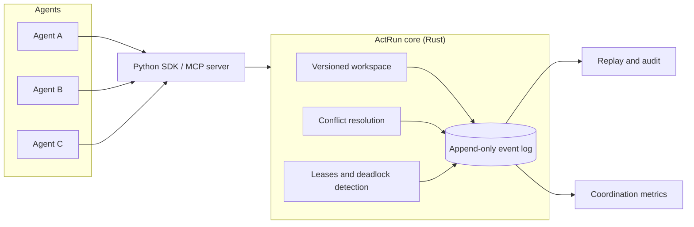

<div align="center">

# ActRun

**Shared state and coordination for multi-agent systems.**

Versioned workspaces, conflict resolution and replayable audit logs, so your agents stop overwriting each other.

[](LICENSE)
[](#status)
[](python/)
[](rust/)

</div>

> **Early development.** ActRun is an experimental prototype. The vision below is a design direction, not a feature list. The [Status](#status) section says exactly what works today and what does not. APIs and the event format will change.

---

## The problem

One agent writing to a codebase, a database or a document works fine. Put three of them on the same task and things start to break:

- Two agents edit the same file and one silently erases the other's work.
- Agents duplicate effort, loop, or wait on each other forever.
- Something goes wrong and nobody can say **which agent changed what, when, and why**.
- You cannot replay a failed run to understand it.

Agent frameworks help you *define* agents and workflows. Very little exists for what happens when several agents **share mutable state**. That is the gap ActRun explores.

## What ActRun is

ActRun is a small, framework-agnostic coordination layer. It sits between your agents and the state they share, and it gives that state the guarantees we expect from any other concurrent system:

| Idea | What it means |
| --- | --- |
| **Versioned shared workspace** | Every agent works on its own branch of the shared state, with snapshots you can inspect and roll back. |
| **Conflict detection and resolution** | Concurrent edits are detected, never silently overwritten. Merge strategies are pluggable, with a hook for an arbiter (a rule, a human, or another agent). |
| **Leases and deadlock detection** | Agents can claim a resource for a bounded time. Circular waits are detected instead of hanging. |
| **Append-only event log** | Every action is recorded as a structured event. The log is the source of truth, so audit and replay come for free. |
| **Coordination metrics** | Measure what actually goes wrong: conflicts, duplicated work, loops, coordination overhead. |

ActRun is designed to sit **alongside** your existing agent framework, not replace it.

## Status

| Area | State |
| --- | --- |
| Async Python runtime (model/tool loop, tool registry, step limits, per-tool timeouts) | **Available (prototype)** |
| Structured JSONL event recording | **Available (prototype)** |
| Exact-match evaluation | **Available (prototype)** |
| Rust trace engine (aggregates metrics from JSONL events) | **Available (prototype)** |
| Shared workspace, branching, snapshots | In design |
| Conflict detection and merge strategies | In design |
| Leases and deadlock detection | Planned |
| Deterministic replay | Planned |
| MCP server and framework integrations | Planned |
| Coordination benchmark | Planned |

The prototype in this repository is the foundation: a runtime that records what agents do, and tooling that reads those records. The coordination layer is being built on top of it.

## Architecture (design direction)



Principles:

- **Event-sourced.** The log is the source of truth. Workspace state is derived from it.
- **Framework-agnostic.** No dependency on a specific agent framework or model provider.
- **Small core.** Prefer a few well-tested primitives over a large abstraction surface.
- **Honest measurement.** Distinguish what is measured from what is assumed.

## API sketch

> **Design sketch only. This API does not exist yet.** It is shown to make the direction concrete and to invite feedback.

```python
from actrun import Workspace, merge

ws = Workspace.open("./runs/feature-x")

# Each agent works on its own branch of the shared state.
agent_a = ws.branch("agent-a")
agent_b = ws.branch("agent-b")

agent_a.write("spec/auth.md", draft_a)
agent_b.write("spec/auth.md", draft_b)

# Concurrent edits to the same path are detected, not silently overwritten.
result = ws.merge(
    [agent_a, agent_b],
    strategy=merge.three_way(fallback="arbiter"),
)

for conflict in result.conflicts:
    print(conflict.path, conflict.branches)

# Claim a resource for a bounded time.
with ws.lease("db/schema.sql", holder="agent-a", ttl_seconds=60):
    ...
```

## Try what exists today

Requirements: Python 3.10+, Git, and the Rust toolchain if you want the trace engine.

```bash
git clone https://github.com/chrismsmr-celcom/ActRun.git
cd ActRun

# Python runtime and tests
cd python
python -m pip install -e ".[dev]"
pytest

# Rust trace engine
cd ../rust/trace-engine
cargo test
cargo run -- ../../example-trace.jsonl
```

The Python runtime currently ships as `open-agent-harness` and imports as `agent_harness`. It will be renamed to `actrun` ([roadmap](#roadmap)).

Event payloads may contain task text, tool arguments or other application data. Do not write secrets or sensitive production data to event logs without your own redaction and access controls.

## What ActRun is not

- **Not an agent framework.** It does not define your agents or workflows.
- **Not a model provider or a model adapter collection.**
- **Not a security boundary.** Registered tools run with the permissions of the host process. Do not use it to execute untrusted code.
- **Not a hosted service.** It is a library and a set of tools you run yourself.

## Why Rust and Python

Agents live in Python, so the SDK is Python. The parts where correctness and throughput matter most, concurrency semantics and log processing, belong in a memory-safe systems language. Rust enters the core only where it earns its place: until a component is measured, the Python implementation stays the reference.

## Roadmap

Milestones are ordered, not dated.

- [ ] **M0 Foundations**: CI, rename the package to `actrun`, specify the event schema, stabilize the public Python API.
- [ ] **M1 Shared workspace**: Rust core with event log and workspace, branches and snapshots, optimistic concurrency, Python bindings.
- [ ] **M2 Conflicts and leases**: merge strategies, arbiter hooks, leases, deadlock detection.
- [ ] **M3 Observability**: deterministic replay, coordination metrics, a CLI trace viewer.
- [ ] **M4 Integrations**: MCP server, examples for common agent frameworks, a coordination benchmark.

Items may change based on testing and feedback.

## Help shape it

The most valuable contribution right now is **evidence**. If you run several agents against shared state, we want to hear what actually breaks for you:

- Open an issue describing a concrete failure: two agents clobbering each other, a deadlock, a run you could not reproduce.
- Tell us which primitives you would trust and which you would not.
- Challenge the design. If a piece of the sketch above is wrong, say so.

Code contributions are welcome too. Please read [CONTRIBUTING.md](CONTRIBUTING.md) first.

## Security

ActRun is experimental software. Please read [SECURITY.md](SECURITY.md) before reporting a vulnerability or using it in a sensitive environment.

## License

MIT. See [LICENSE](LICENSE).
